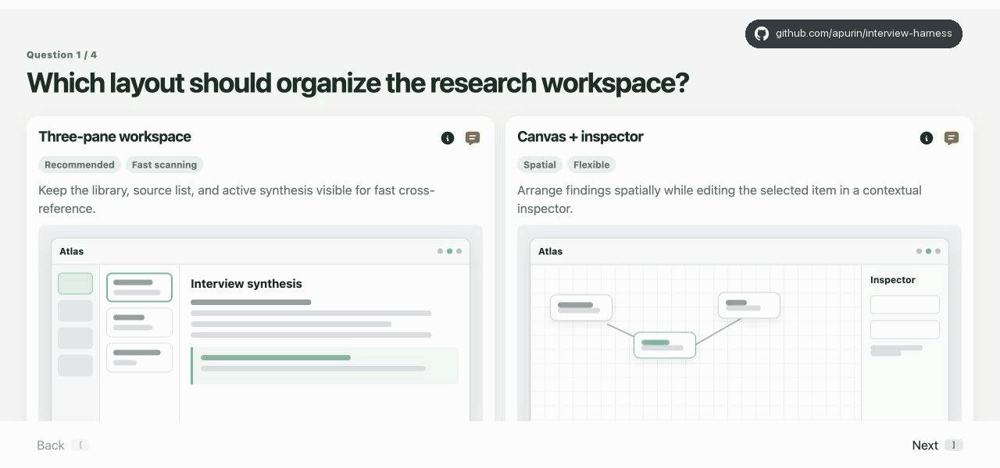

# Interview Harness

**Turn an agent’s questions into one clear visual decision session.**

Interview Harness is an authoring skill and browser library for decisions that are difficult to resolve in chat. An AI agent creates a temporary local interview with concrete options, comparisons, plans, flows, sequences, or drafts; you review them in one session and return a concise record of your selections, changes, and comments.



Concrete material is easier to evaluate than a blank prompt. It helps crystallize a user’s vision and intent before implementation begins. You can compare alternatives, correct assumptions, combine parts of different proposals, and attach comments to the exact item they concern. The agent receives a coherent decision context it can act on, preserving nuance and reducing avoidable rework.

Each interview is a readable HTML file opened directly in your browser. It requires no account, hosted application, deployment, or backend. Interview Harness does not upload your responses; state remains in the browser until you copy or export it.

Interview Harness is free and open source under the [MIT License](LICENSE). The library and authoring skills are public, readable, and unminified.

## What it supports

A single interview can combine several forms of review:

| Type | Use |
| --- | --- |
| `choice` | Select one or several options from plain or visual cards |
| `compare` | Evaluate alternatives against shared criteria |
| `categorize` | Organize items into buckets using board or table views |
| `flow` | Review and correct proposed states, decisions, and transitions |
| `sequence` | Review and correct a proposed exchange between participants |
| `edit` | Revise a proposed text or code artifact |

Cards can include Markdown, labels, tooltips, and inline or file-based previews. Comments can be attached to options, comparison criteria, buckets, flow elements, sequences, and edits—including items you do not select.

The library handles layout, navigation, progress, selection, editing, local state, Light and Dark themes, and concise text export. The generated file contains the interview content and loads the exact runtime version used to create it.

## Give it to an agent

Install the authoring skill:

```sh
npx skills add apurin/interview-harness --list
```

Without installing anything, tell your agent: “Run an interactive interview for this project using the instructions in the [latest Interview Harness skill](https://cdn.jsdelivr.net/gh/apurin/interview-harness@latest/skills/interview-harness/SKILL.md).” Try it with a new or existing project in about a minute.

The skill teaches the agent when an interview is useful, which questions belong in it, and how to generate the local HTML file. Open the file, complete the interview, and return its exported answer to the agent.

The complete authoring reference is available in [skills/interview-harness/SKILL.md](skills/interview-harness/SKILL.md).

<details>
<summary>Maintaining the project</summary>

Maintenance policy lives in [AGENTS.md](AGENTS.md).

The README animation source and capture workflow live in [demo/](demo/README.md).

Release with:

```sh
node scripts/release.mjs X.Y.Z
```

The release script renders the skills with an exact-version runtime URL, commits and tags the release, pushes it, and refreshes the latest skill on jsDelivr.

</details>
